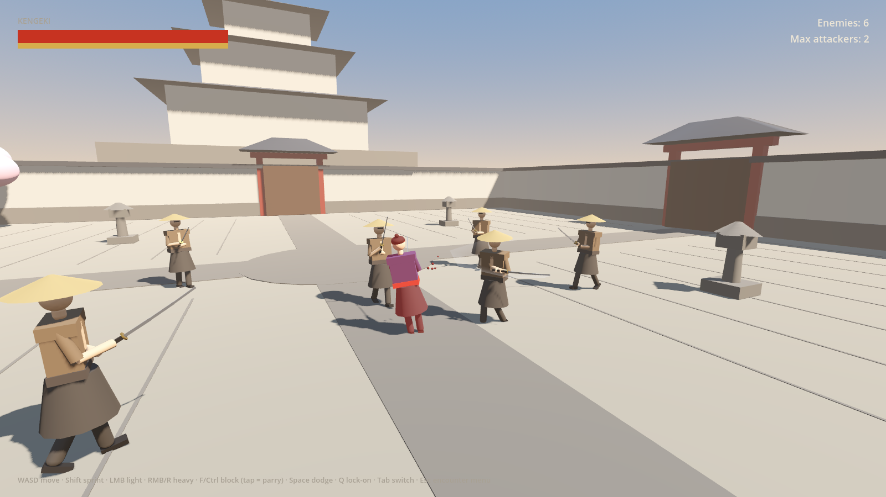

# KENGEKI — playable foundation

Single-player, third-person katana combat sandbox set in a feudal Japanese castle courtyard.
Built with **Godot 4.3** (GDScript, no external dependencies). This version uses placeholder
art, placeholder animation and procedurally generated placeholder audio. Every one of those is
built to be swapped for the Hunyuan models, animations and courtyard and for the final music
and SFX.



## Launching

> **Player character.** The player uses the AccuRIG samurai from
> `assets/models/kengeki/kengeki_character_animated.glb`. That GLB is a private asset and is
> **not in git**; copy it from `Kengeki/assets/animation_pipeline_output/` before opening the
> project (see [docs/CHARACTER_INTEGRATION.md](docs/CHARACTER_INTEGRATION.md)). The committed
> `release/KENGEKI-windows-x86_64.zip` is the earlier placeholder-character build; the
> integrated build is produced locally and kept out of the repository with the asset.

**Windows build:** unzip `release/KENGEKI-windows-x86_64.zip` and run `KENGEKI.exe`. It is a
single file with the game data embedded. It has not been launched on Windows. See
[Testing](docs/IMPLEMENTATION_REPORT.md#4-testing) for what was verified.

**From source:**
1. Install [Godot 4.3](https://godotengine.org/download/archive/4.3-stable/) (standard build, not .NET).
2. In the Project Manager, choose **Import** and pick `project.godot` in this folder.
3. Press **F5**. The main scene is `scenes/main.tscn`.

**Re-exporting:** install the 4.3 export templates, then use *Project → Export → Windows Desktop*
(the preset is already set up). Or run:
`godot --headless --path . --export-release "Windows Desktop" build/windows/KENGEKI.exe`

## Playing

The game starts with the **Encounter menu** open:
1. Set **Enemies to spawn** (1–10).
2. Optionally adjust the **Spawn interval** (default 2 s) and **Max simultaneous attackers** (default 2).
3. Press **Spawn enemies**. Ronin enter one at a time from the courtyard gates.

Press **Esc** (or **M**) at any time to reopen the menu. The game pauses while it is open. From
the menu you can spawn more enemies, clear them, restore health and stamina, or reset the
encounter. When you die you can **Restart** (same enemy count) or **Return to arena**.

| Action | Keyboard / mouse | Gamepad |
|---|---|---|
| Move | W A S D | Left stick |
| Camera | Mouse | Right stick |
| Camera distance | Mouse wheel | — |
| Sprint | Shift (hold) | L3 |
| Light attack | Left mouse | X / □ |
| Heavy attack | Right mouse or R | Y / △ |
| Block (hold) / **parry** (tap just before a hit) | F or Ctrl (or mouse button 4) | LB / L1 |
| Dodge (in move direction) | Space | B / ○ |
| Jump | C | A / ✕ |
| Draw / sheathe katana | E (attacking or blocking while sheathed draws first) | D-pad up |
| Lock-on toggle | Q or middle mouse | R3 |
| Switch target | Tab, or flick the mouse while locked | RB / R1 |
| Encounter menu | Esc or M | Start |

### Techniques

| Input | Technique |
|---|---|
| L, L, L | Light Cut I → Light Cut II → **Crescent Wheel** (360° combo finisher, hits everything around you) |
| L, L, H | Light Cut I → Light Cut II → **Kesa-giri** (heavy combo finisher, knocks down) |
| L, H | Light Cut → **Rising Cut** |
| H, L | Overhead Cut → **Piercing Thrust** |
| H | **Overhead Cut** (hyper armor, breaks guards) |
| Block tapped just before a hit, then L or H | **Parry → Kaeshi-waza counter** (cinematic counterattack) |
| H next to a staggered, parried or guard-broken enemy | **Todome finishing strike** |

* Pressing an attack during the current swing **buffers** it into the next hit of the combo.
* A dodge can cancel the start of light attacks and the recovery of any attack.
* Enemies block more often if you only spam light attacks. Heavy attacks break their guard.
* An enemy's **overhead strike cannot be interrupted** (hyper armor). It is signalled by a
  wooden clack and a high wind-up. Dodge it or parry it.

## Documentation

* [Implementation report, test results and known limitations](docs/IMPLEMENTATION_REPORT.md)
* [Asset integration guide: replacing placeholders with Hunyuan assets](docs/ASSET_INTEGRATION.md)
* [Audio guide: categories, file locations and what is a placeholder](docs/AUDIO.md)
* [Character integration: AccuRIG samurai, animations, root motion, katana](docs/CHARACTER_INTEGRATION.md)

## Project layout

```
autoload/      GameInput (bindings), AudioManager, CombatFX (hit-stop/shake/particles), CombatManager (hit rules)
scenes/        main, arena, characters (player, enemy, visuals), weapons (katana), camera
scripts/       components/ combat/ characters/ player/ enemy/(+states/) camera/ encounter/ arena/ visual/ vfx/ ui/
resources/     attacks/player/*.tres, attacks/enemy/*.tres  (all attack timing and damage, editable in the inspector)
audio/         sfx/<category>/*.wav, music/*.wav   (drop-in replaceable)
assets/        empty folders for the Hunyuan models, animations and environment
tests/         automated gameplay tests (tools/run_tests.sh)
tools/         placeholder audio and attack generators, screenshot capture, test runner
release/       zipped Windows build
```
